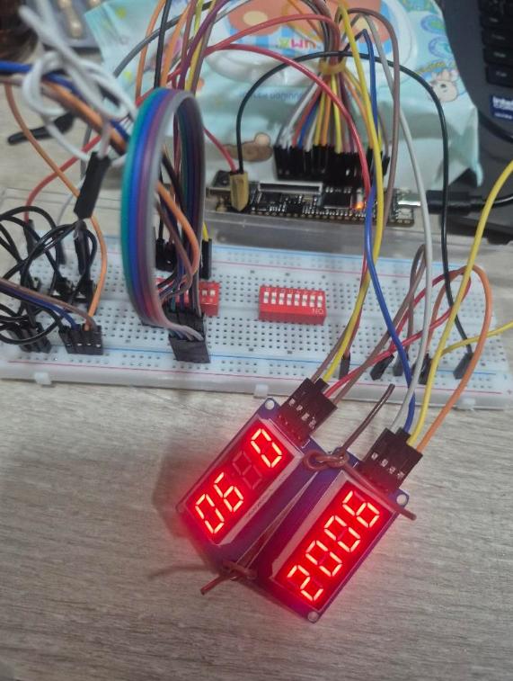

# Single-Board Computer

A small computer with a 14-bit CPU, designed in Digital and run on an FPGA board.

**Built with:** Digital, Verilog, Gowin FPGA

Team project (3 people) for Computer Architecture and Organization, KMITL 2026. My part was the digital design in Digital, the Verilog export and the tests. My two teammates built the hardware, wrote the sample programs and ran the live demo.



## Features
- Custom 14-bit CPU: load/store, add/subtract, branches
- Front panel: enter programs with DIP switches and buttons
- Single-step and continuous run, stops by itself on halt
- 9 automated tests, all passing

## Running it

Open `sbc.dig` in Digital and keep all files in the same folder, since it loads the others by name. To run the tests, use "Run all tests" in Digital.

The same tests also run against the exported Verilog with Icarus Verilog:

```bash
sh verilog_tests/check_verilog.sh
```
